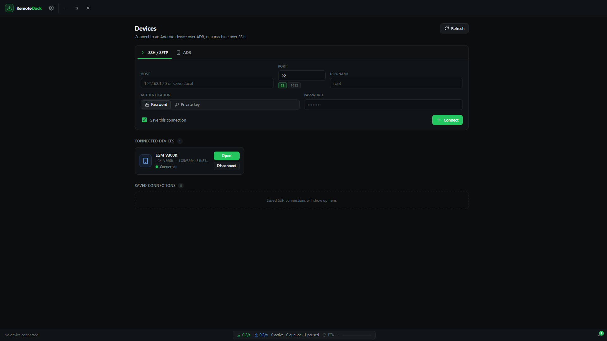

# RemoteDock

Browse and transfer files on remote devices over SSH/SFTP or ADB with a clean, desktop UI.



## Features

- **SSH & SFTP:** Connect to Linux servers, Raspberry Pis, and Termux on Android over SFTP.
- **ADB Support:** Connect to Android devices via USB or Wi-Fi (wireless debugging).
- **Dual Connection Manager:** Save credentials, manage known hosts, and auto-reconnect.
- **Fast File Transfer:** Resumable file transfers with checksum verification and speed metering.
- **Dark UI:** Sleek, responsive interface built with React and Tailwind tokens.

## Getting Started

### Prerequisites

- [Node.js](https://nodejs.org/) (v20+)
- npm

### Installation

```bash
git clone https://github.com/dearprince147-ops/remote-dock.git
cd remote-dock
npm install
```

> `npm install` automatically provisions local Android Debug Bridge (ADB) binaries into `resources/adb/`.

### Development

```bash
npm run dev
```

### Build Installer

```bash
npm run dist
```

Installers are generated in the `release/` directory.

## License

MIT
