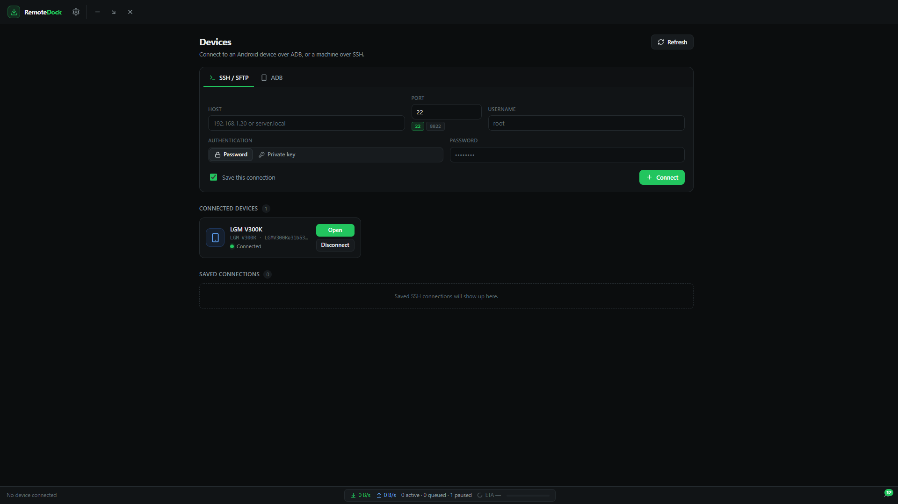
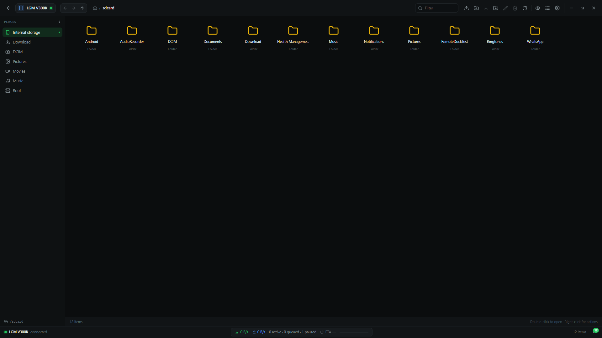

# RemoteDock

<p align="center">
  <strong>Browse, manage, and transfer files on remote devices over SSH/SFTP or ADB with a sleek, high-performance desktop interface.</strong>
</p>

<p align="center">
  
  
  
  
  
  
</p>

<p align="center">
  
</p>

---

## Overview

**RemoteDock** is a modern desktop file manager engineered for developers, power users, and sysadmins who work across physical devices. Whether you are managing files on an Android smartphone, a Raspberry Pi on your local network, or a remote Linux server, RemoteDock provides a unified, responsive interface without needing command-line tools or slow MTP connections.

RemoteDock natively supports two primary protocols:
1. **ADB (Android Debug Bridge):** High-speed direct access to Android filesystems over USB or Wi-Fi with zero setup (ADB binaries are bundled).
2. **SSH / SFTP (Secure File Transfer Protocol):** Encrypted remote filesystem access to Linux, Unix, macOS, and Termux environments.

---

## Screenshots

<div align="center">
  <table>
    <tr>
      <td align="center"><strong>Device Manager (ADB & SSH)</strong></td>
      <td align="center"><strong>File Explorer & Transfers Drawer</strong></td>
    </tr>
    <tr>
      <td></td>
      <td></td>
    </tr>
  </table>
</div>

---

## How It Works: The Protocols

### 1. ADB (Android Debug Bridge)
Instead of relying on fragile and sluggish Windows MTP (Media Transfer Protocol) connections, RemoteDock speaks directly to Android devices via the Android Debug Bridge:
* **Bundled & Zero-Setup:** RemoteDock bundles standalone Windows ADB binaries (`adb.exe` and required DLLs). You do **not** need Android Studio or the Android SDK command-line tools installed.
* **Live USB Auto-Detection:** A continuous tracker detects Android devices the moment they are plugged in or unplugged.
* **Wireless Debugging (Wi-Fi):** Connect to any Android device on your local Wi-Fi network using its IP address and pairing/debugging port.
* **Native Android Filesystem Access:** Browse internal storage (`/sdcard`, `/storage/emulated/0`), app sandboxes, downloads, DCIM camera reels, and root filesystems (if rooted).

### 2. SSH / SFTP (Secure File Transfer Protocol)
RemoteDock connects to servers and devices running an OpenSSH server:
* **Binary SFTP Stream:** File browsing, directory reads, and file transfers are carried out over the SFTP subsystem.
* **Credential Encryption:** Passwords and private key passphrases are securely encrypted at rest using Windows DPAPI (via Electron's `safeStorage`).
* **Host Key Verification:** Prevents Man-in-the-Middle (MITM) attacks by computing and matching SHA-256 host key fingerprints with interactive confirmation for new or modified servers.
* **Clean Stream Diagnostics:** Automatically detects and alerts if remote shells (e.g., in Termux or misconfigured `.bashrc`) leak text output into non-interactive SFTP streams.

---

## Key Features

### 📁 High-Performance File Explorer
* **Dual View Modes:** Toggle instantly between **Virtual List View** and **Grid View**.
* **Virtual Scrolling:** Powered by `@tanstack/react-virtual`, capable of smoothly rendering directories with tens of thousands of files without UI stutter.
* **Quick Links Sidebar:** One-click shortcuts to Home, Root, Internal Storage, Downloads, Pictures, DCIM Camera, Movies, and Music.
* **Breadcrumb Navigation:** Clickable hierarchical breadcrumbs with direct path input.
* **Sorting & Filtering:** Sort by name, file size, or last modified date in ascending or descending order. Toggle hidden files (dotfiles) with a single click.
* **Context Actions:** Full context menu and keyboard shortcuts for Download, Upload, New Folder, Rename, Delete, and Path Copying.

### ⚡ Resumable Transfer Engine
* **Bi-directional Transfers:** Upload files/folders from your PC to the remote device or download from the device to your PC.
* **Automatic Resume (`.part` files):** If a transfer is interrupted or paused, RemoteDock resumes from the exact byte offset where it left off — no restarting large downloads from 0%.
* **Live Speed & ETA Metering:** Real-time upload/download speed metrics (switchable between `MB/s` and `Mbps`) with dynamic ETA calculations.
* **Bandwidth Throttling:** Limit transfer bandwidth to prevent saturating your local network.
* **Concurrency Controls:** Configure the number of parallel transfers (1 to 8 concurrent streams).
* **Conflict Resolution Policies:** Choose default behavior when destination files exist:
  * **Rename:** Automatically creates `filename (1).ext`.
  * **Overwrite:** Safely replaces the existing file.
  * **Skip:** Bypasses conflicting files without touching existing data.
* **Hash Verification:** Optional post-transfer SHA-256 checksum verification to guarantee data integrity.
* **Transfers Drawer:** Collapsible bottom drawer monitoring active, queued, paused, completed, and failed jobs.

### 🔒 Device & Credential Management
* **Dual Authentication:** Connect to SSH hosts using either password authentication or OpenSSH private keys (with optional passphrase).
* **Saved Connections:** Save frequently accessed hosts with custom labels and credentials.
* **Auto-Reconnect:** Automatic background reconnect with exponential backoff if a Wi-Fi or SSH connection drops.
* **Known Hosts Manager:** View, manage, and delete trusted host fingerprints directly from the Settings tab.

### 🎨 Clean, Modern Dark Interface
* Customizable UI accent colors (Emerald, Cyan, Violet, Amber, Crimson, etc.).
* Confirmation safety guards to prevent accidental deletion of remote files.
* Accessible keyboard navigation.

---

## Getting Started

### Option A: Install via Setup Executable (Recommended)

1. Head to the **[Releases](https://github.com/dearprince147-ops/remote-dock/releases)** tab.
2. Download the latest installer: `RemoteDock-Setup-1.0.1.exe`.
3. Run the installer. RemoteDock will install and launch automatically.

---

### Option B: Run from Source

#### Prerequisites
* [Node.js](https://nodejs.org/) (v20 or higher)
* npm (v10 or higher)
* Windows 10/11 (64-bit)

#### Build & Run
```bash
# Clone the repository
git clone https://github.com/dearprince147-ops/remote-dock.git
cd remote-dock

# Install dependencies (automatically provisions bundled ADB binaries)
npm install

# Start the application in development mode with hot reload
npm run dev
```

#### Build Installer
```bash
# Build production NSIS installer
npm run dist
```
The compiled installer will be output to the `release/` directory.

---

## Connection Guides

### Connecting to Android via ADB

1. **Enable Developer Options on your phone:**
   * Go to **Settings** > **About Phone**.
   * Tap **Build Number** 7 times until you see *"You are now a developer!"*.
2. **Enable USB Debugging:**
   * Go to **Settings** > **Developer Options** and toggle **USB Debugging** on.
3. **Connect via USB:**
   * Plug your phone into your PC via USB.
   * RemoteDock will automatically detect the device under **Connected Devices**.
   * Unlock your phone and tap **Allow** on the *"Allow USB debugging?"* prompt.
   * Click **Open** in RemoteDock to browse your phone's files!
4. **Connect via Wireless ADB (Optional):**
   * Enable **Wireless Debugging** in Developer Options.
   * In RemoteDock, switch to the **ADB** tab, select **Wi-Fi**, enter the IP address and port shown on your phone, and click **Connect**.

---

### Connecting to SSH / SFTP (Linux, Pi, Termux)

1. In RemoteDock, select the **SSH / SFTP** tab.
2. Enter your device's connection details:
   * **Host:** IP address or hostname (e.g. `192.168.1.5` or `raspberrypi.local`).
   * **Port:** Port number (default `22` for Linux/Raspberry Pi; default `8022` for Termux).
   * **Username:** Remote user name (e.g. `root`, `pi`, or your Termux user `u0_a...`).
   * **Authentication:** Select **Password** or browse for an OpenSSH **Private Key** file.
3. Check **Save this connection** to save credentials for one-click access in the future.
4. Click **+ Connect**.

> **Tip for Termux Users:**
> SFTP requires a clean binary stream. If your remote shell startup file (`~/.bashrc`) prints a welcome banner or `neofetch`, SFTP initialization will fail. To ensure smooth connections with Termux:
> Open `$PREFIX/etc/ssh/sshd_config` and set:
> ```text
> Subsystem sftp internal-sftp
> ```
> Then restart SSH with `pkill sshd && sshd`.

---

## Architecture & Security

```
┌─────────────────────────────────────────────────────────────┐
│                       Renderer Process                      │
│     React 19 • Virtualized UI • Zustand State Store         │
└──────────────────────────────┬──────────────────────────────┘
                               │  Preload Bridge (IPC)
┌──────────────────────────────▼──────────────────────────────┐
│                         Main Process                        │
│                 Electron 45 • Node.js Runtime               │
│                                                             │
│   ┌───────────────────────┐     ┌───────────────────────┐   │
│   │   AdbProvider (CLI)   │     │   SshDevice (ssh2)    │   │
│   │   Streaming ADB Push/ │     │   SFTP Subsystem      │   │
│   │   Pull & Shell Sync   │     │   Host Key Verifier   │   │
│   └───────────┬───────────┘     └───────────┬───────────┘   │
│               │                             │               │
│               ▼                             ▼               │
│   ┌─────────────────────────────────────────────────────┐   │
│   │                Transfer Engine Core                 │   │
│   │   Chunked Streams • Resumption • SHA256 Verification│   │
│   └─────────────────────────────────────────────────────┘   │
└─────────────────────────────────────────────────────────────┘
```

* **Sandboxed Renderer:** The UI renderer has zero direct access to Node.js or the local filesystem. All system operations go through an explicit preload IPC bridge.
* **Zero Whole-File Buffering:** File transfers stream directly between local storage and the remote connection in controlled 256 KB chunks, ensuring minimal memory consumption even when transferring 50+ GB files.
* **Encrypted Secrets:** Stored SSH passwords and passphrases are never stored in plaintext; they are encrypted with the OS key store.

---

## Keyboard Shortcuts

| Shortcut | Action |
| :--- | :--- |
| `Ctrl + R` / `F5` | Refresh current directory |
| `Ctrl + H` | Toggle hidden files |
| `Ctrl + Shift + N` | Create a new folder |
| `F2` | Rename selected item |
| `Delete` | Delete selected item |
| `Backspace` / `Alt + Up` | Go to parent directory |
| `Ctrl + F` | Filter / search files in directory |
| `Esc` | Clear selection / close dialogs |

---

## Tech Stack

* **Framework:** [Electron 45](https://www.electronjs.org/) + [electron-vite](https://electron-vite.org/)
* **Frontend:** [React 19](https://react.dev/), [TypeScript](https://www.typescriptlang.org/), [Tailwind CSS tokens](https://tailwindcss.com/)
* **State Management:** [Zustand 5](https://github.com/pmndrs/zustand)
* **Virtualization:** [@tanstack/react-virtual](https://tanstack.com/virtual/latest)
* **Icons:** [Lucide Icons](https://lucide.dev/)
* **SSH & SFTP Engine:** [ssh2](https://github.com/mscdex/ssh2)
* **Packaging:** [electron-builder](https://www.electron.build/) (NSIS x64 Target)

---

## Contributing

Contributions, bug reports, and suggestions are welcome!
1. Fork the repository.
2. Create your branch (`git checkout -b feature/amazing-feature`).
3. Commit your changes (`git commit -m "Add amazing feature"`).
4. Push to the branch (`git push origin feature/amazing-feature`).
5. Open a Pull Request.

---

## License

This project is licensed under the **MIT License** — see the [LICENSE](LICENSE) file for details.
